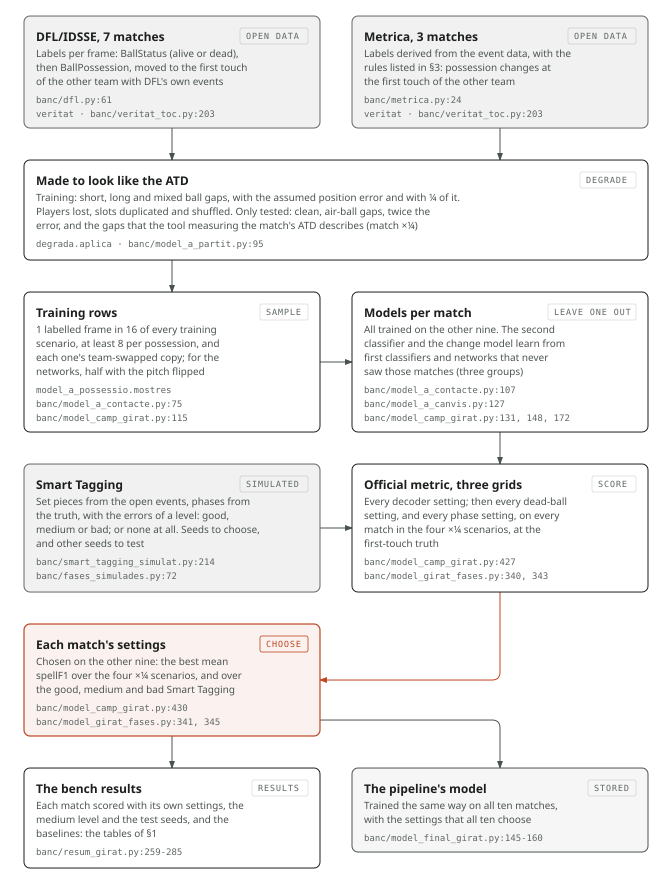

# Team possession per video frame from tracking and Smart Tagging

More than a Hack 2027 · Phase 1 · technical document

Every number in this document comes from open data. No model was trained on the provided match, and no setting was
tuned or chosen with its labels or its video. From the match we take its inputs and a few outcomes, all described in
[§2](#2-which-assets-we-used-and-how):
- **the inputs of the model:** the tactical ATD and the Smart Tagging;
- **one check of the tactical ATD,** run locally, which prints only its outcome: its ball is in sync with the
  tactical video, and jitters like our bench with a quarter of the position error we had assumed. That quarter sets
  the position error of half our training scenarios;
- **one measurement of the ATD's ball gaps,** run locally, which prints only which of our candidate patterns they
  resemble, in words. It gives one more test scenario, which chooses nothing;
- **the labelling convention:** the public 5-minute window's truth, looked at with the tactical video, changes
  possession at the first touch of the other team. We rebuilt our open labels to that convention for choosing and
  scoring ([§3](#3-training-data));
- **after writing the file,** the pipeline check on the public window that the rules allow, which prints only pass
  or fail. Once the file was final, it was also scored on this window with the official scorer
  (`run_evaluation.py`), as a check of the pipeline, as [EVALUATION.md] asks. It chose nothing, and nothing changed
  after it.

**Claude, an AI assistant.** The code and this document were written with Claude (Anthropic), through Claude Code,
under the team's direction. The pipeline itself uses no LLM. The match's data never left our machines, and Claude
never received them or any extract of them: everything that ran on them, a team member ran locally, and a hook in
Claude Code blocked its access to the encrypted volume that held them.

## 1. The approach

**What we built.** The submission is the output of one command (`python -I -m cadena`). It reads the tactical ATD
and the Smart Tagging, and runs nine stages on every scored half, separately (Figure 1):


1. **A credible ball.** On the ten open matches, clean, a ball out of play never goes more than 10 m beyond the
   lines. Seen farther, it is a tracking error (on our bench, a ball in the air drawn on the ground), so it is
   treated as missing, as in a gap. Players are not touched.
2. **152 signals per video frame**, all collective. ATD slots have no stable identity, so no signal follows a
   player.
   - **105 describe the configuration:**
     - the ball and its nearest opponents: the distance from the ball to each team's nearest player, and how many
       players of each team are within 3 m and 10 m;
     - each team's block: its centroid, its most advanced and deepest players, its spread, its speed, how many
       players are still, and how many are in their own half;
     - dead-ball cues: the ball outside the pitch, near a line, a corner or the centre spot, or not moving; all
       players still, or all in their own half (a kick-off).

     Distances are in metres, and the x axis follows each team's attack direction. Some signals are averaged over
     rolling windows of 1, 5 and 10 s, or of 2 and 5 s looking only back or only ahead, and some are shifted by ±1
     and ±2 s. When the ball is missing, they say how long since it was last seen and how long until it is seen
     again, and carry over what the ball and the players looked like at both ends of the gap.
   - **29 describe touches and control**, because possession changes only when a player of the other team takes the
     ball ([CHALLENGE.md]):
     - a **touch** is a frame where the ball changes speed or direction by 5 m/s or more, with a player within 2 m.
       The velocities before and after come from straight lines fitted to the 5 frames on each side, which damps
       the jitter. Its team is the nearest player's. The signals give the team of the last touch and of the next,
       how long ago and how soon, how hard and how contested each was, the team of the touch before last, and how
       many touches each team made in the 1 and 3 s around the frame, and in the 2 s before and after;
     - **control**: the ball's speed relative to each team's nearest player, and how much of the last second and of
       the next one a player of each team is within 1.5 m of the ball with the ball moving with him (3 m/s or less
       apart);
     - **the ball's jitter** in the half, which says how far touches and control can be trusted.
   - **18 describe the last contact**, by proximity rather than by a change of speed, which noise can fake or hide.
     A contact is a run of frames with a player within 1 m (and, separately, 2 m) of the ball; with players of both
     teams, the nearest one's team. For each radius: the team of the last contact, of the next and of the one
     before last; how long since the last ended and until the next starts; how long each lasted, which tells a
     touch in passing from a dribble; and how close each team's nearest player was at the end of the last one.

   No window crosses from one half to the other.
3. **A first LightGBM classifier** turns the 152 signals into P(H), P(A), P(D). Every training frame is in it twice:
   as is, and with the two teams swapped (and H and A swapped in its label). At prediction, its output is the
   average of both views, the second one swapped back. So H and A are treated symmetrically, and swapping the teams
   in the input swaps them in the output. Every classifier and network below is trained and averaged the same way.
4. **54 context signals** describe the first classifier's output around each frame: P(H) − P(A) and P(D) shifted by
   up to ±5 s, their means over centred windows of up to 10 s and over windows of up to 5 s looking only back or
   only ahead, and the highest P(H) and P(A) within 1 and 5 s. They show the shape of a change: how long the
   evidence for the other team lasts, and whether what comes after goes back to the team before.
5. **Five small neural networks** read the positions themselves, rather than the summaries above. At each frame they
   see:
   - the ball, and where the ball is missing, an estimate of it: a straight line at constant speed from where it was
     last seen to where it is seen again (at the start or end of a half, still at the nearest sighting), with how
     long since it was seen and until it is seen again. Around it, where the three players of each team nearest to
     it are and how they move, relative to the ball, with the x axis along the home team's attack: 31 values, at 25
     frames within ±2 s (775 inputs);
   - both whole teams: of each, 11 players with their position and velocity, ordered from their own goal to the
     other one, and how many are seen (missing ones at the mean of the seen ones, duplicates removed): 90 values, at
     9 frames within ±2 s (810 inputs).

   Each is a scikit-learn perceptron with two hidden layers (256 and 128 units), trained for 15 epochs on the same
   frames as the classifiers, half of them with the pitch flipped top to bottom (y becomes 1 − y), which is the same
   football mirrored. The five differ only in their random seed. At prediction, each one is the mean of four views:
   as is, with the teams swapped, with the pitch flipped, and both. Their mean P(H), P(A), P(D), with the same kind
   of context as stage 4, makes 57 signals. The networks are stored as arrays and computed with numpy, and their
   output is rounded to 1/1024, once, so that the last digit of a product, which can differ between CPUs, does not
   reach the file.
6. **A change model**, a third LightGBM classifier on the 206 signals of stages 2 and 4, gives q: the probability
   that the true team changes within 6 frames (0.24 s) of the frame.
7. **A second LightGBM classifier** gives the final P(H), P(A), P(D) from 271 signals: the 206, the 57 of the
   networks, and 8 that describe stoppages: how far out of the pitch the ball is, or would be had it kept its last
   velocity, and how soon it would cross the line; how much the players slow down or speed up over the last and next
   1, 2 and 4 s, and how many brake hard; and how long the ball has been still and will stay still.
8. **The Smart Tagging, as evidence.** On log(P / prior) of each class, before decoding:
   - **each set piece** adds 1 per frame to D, over the dead ball before its restart: a span that ends where the
     set piece starts and lasts 1.5 times the median dead ball before restarts of its type on the ten open matches;
   - **each tagged phase that names the team on the ball** (Build Up, Progression, Creating Chances, Ball in Final
     Third, Ball in the Box and Attacking Transition, [DATA.md]) takes 1 per frame from the other team and 1 from D,
     on every frame inside it. Where phases of both teams overlap, nothing is taken. The defensive phases are not
     used. They name the team that defends. On the bench, flipped to the team on the ball and added to the attacking
     phases, they gained at most +0.006, short of the +0.04 we required (`model-girat-defenses.md`);
   - **D is ruled out** where stage 1 removed the ball: a frame the tracking got wrong is not evidence of a stoppage.

   The set pieces' own team is not used: on the bench, adding to the team after a restart did not help.
   **Before using the phases,** the command checks their team: decoded without the Smart Tagging, the model must give
   the phase's team in more than half of the frames inside the phases. If it does not, the Smart Tagging may have the
   teams the other way round, and taking from the right team would do harm, so the command stops. It also stops if
   there is no phase with a team.
9. **A Viterbi decoder** turns the evidence into whole possessions. It maximises the sum of the evidence minus a
   cost for every change of label. Switching between H and A at a frame costs w · (−ln q), with w = 4: it is cheap
   where the change model expects a change, and dear where it does not (about 9 where q = 0.1, about 28 where
   q = 0.001). A change to or from D costs λ = 32. Every run except the first and the last of a half lasts at least
   12 frames (0.48 s). Outside the scored halves it writes `X`.

**Why this rather than something else.**
- **Not a rule.** The published baseline gives the ball to the nearest tracked player, then takes a majority vote
  over a window ([EVALUATION.md]). It breaks where the ATD is weakest:
  - the ball is missing in 41 % of the graded frames;
  - it goes missing disproportionately on the frames that matter, through occlusions, crowded boxes and balls in
    the air ([DATA.md]), which is where possession changes.

  A model of the whole configuration can still say who has the ball when the ball itself is not tracked.
- **Touches as evidence, not as a rule.** We first tried a decoder that only lets possession change at a detected
  touch of the new team. On the bench it did not beat the plain decoder by more than the noise band
  (`codi/banc/resultats/decodificador-tocs.md`): on automatic tracking, a touch detector misses touches and finds
  others that never happened. As signals, the classifiers learn when to trust them. The change model does the same
  for the decoder: where a change is likely, it lets the decoder follow the evidence; elsewhere, it holds the
  possession that is running.
- **Several models, each for what the others miss.** On the bench, most of what a single classifier still lost was
  the team of short possessions: looking at each frame alone, it often cannot tell a short possession from a
  flicker. The second classifier sees the first one's output around the frame. The networks see the players around
  the ball directly, and both whole teams; they add most where the hand-made signals are noisiest, and where the
  ball is missing.
- **The Smart Tagging, at the decoder.** It is the only input that says, in words, when play is stopped and which
  team is building an attack. We first gave its set pieces to the second classifier as signals: it hardly used them
  (`model-pilotes-aturades.md`). As evidence added before the decoder, with a few numbers chosen on the bench, it
  helps, and with no Smart Tagging the model is exactly the one without it.
- **The decoder still matters.** The ranking metric, spellF1, matches whole possessions, and a run of H or A broken
  by a few frames of the other team counts as several. Our final evidence decoded frame by frame (the most likely
  class, with the Smart Tagging and with no cost and no minimum length) scores 0.45-0.53 in the scenarios like the
  ATD (0.67 clean). Through the decoder, it scores 0.68-0.72 (Figure 2).
- **Tracking first, video later.** The tactical video is the reference timeline (row *i* of the file is frame *i* of
  it), and the tactical ATD has one record per frame of it. Reading the video, to find the ball where the ATD lost
  it, needs a ball detector that works on this video, and the open one we tried rarely sees the ball in it
  ([§2](#2-which-assets-we-used-and-how)). The tracking and the Smart Tagging came first, and that is this
  submission.
- **Choosing without the match's labels.** No setting was chosen with the public window or with any label of the
  match. What we took from them is the convention the labels follow ([§2](#2-which-assets-we-used-and-how)):
  - the signals, the models' settings and the degradation scenarios come from the rules' description of the data
    ([DATA.md]), from our earlier prototype on the Metrica sample data, and from the open bench;
  - one number comes from the match's own tracking: the position error of half the training scenarios, a quarter of
    the assumed one, measured on the ATD ball ([§2](#2-which-assets-we-used-and-how));
  - every change to the method, the decoder settings and the Smart Tagging settings were chosen on the open bench,
    at our open labels rebuilt to that convention, leaving one match out at a time, with the criteria written before
    each run ([§3](#3-training-data)).


**Results on the open bench.** The scores are spellF1, the mean of the 10 matches, each scored by models that never
saw it, with the labels at the first touch ([§3](#3-training-data)). Each match's decoder and Smart Tagging settings
were chosen with the other nine. The Smart Tagging is simulated, at the medium level and with seeds that chose
nothing (§3). All of it is in `codi/banc/resultats/resum-girat.md`.

The baselines are our re-implementation of the published one, from its description in [EVALUATION.md], with
windows of 1, 25, 50 and 125 frames. The description does not say what it writes where the ball is missing, so we
score both variants: `X` (·X) and `D` (·D). The table gives the best of the eight in each scenario, and smooth50·X,
the published floor.

| scenario | ball gaps added | position error | our model | best of our baselines | smooth50·X | macroF1, our model |
|------------|---------------|----------|------------|-------------------------|------------|------------------|
| clean | none | none | 0.809 | 0.371 (smooth125·D) | 0.311 | 0.960 |
| short ×¼ | 0.2-3 s | ¼ | 0.718 | 0.254 (smooth125·X) | 0.221 | 0.941 |
| long ×¼ | 3-20 s | ¼ | 0.714 | 0.218 (smooth125·D) | 0.206 | 0.931 |
| mixed ×¼ | 0.2-20 s | ¼ | 0.718 | 0.221 (smooth125·X) | 0.207 | 0.935 |
| air ×¼ | 0.2-20 s, balls in the air | ¼ | 0.676 | 0.225 (smooth125·X) | 0.216 | 0.925 |
| short | 0.2-3 s | assumed | 0.693 | 0.238 (smooth125·X) | 0.187 | 0.931 |
| long | 3-20 s | assumed | 0.674 | 0.197 (smooth125·X) | 0.183 | 0.922 |
| mixed | 0.2-20 s | assumed | 0.675 | 0.207 (smooth125·X) | 0.184 | 0.924 |
| air | 0.2-20 s, balls in the air | assumed | 0.652 | 0.206 (smooth125·X) | 0.183 | 0.915 |
| noise ×2 | 0.2-20 s | twice | 0.600 | 0.164 (smooth125·X) | 0.133 | 0.875 |
| match ×¼ | as measured on the ATD | ¼ | 0.772 | 0.385 (smooth125·D) | 0.270 | 0.952 |

The four ×¼ rows are the ones we train and choose with, like the match's ATD in its position error
([§2](#2-which-assets-we-used-and-how)); match ×¼ is only a test. §3 describes every scenario.

- **Against the baselines.** The model beats the best baseline and smooth50·X in 10 matches of 10, in every
  scenario. Against the best one, the 95 % bootstrap interval of the difference runs from +0.440 to +0.513 in the
  ×¼ scenarios, from +0.433 to +0.495 with the assumed error, +0.420 to +0.452 with twice the error, and +0.371 to
  +0.403 in match ×¼.
- **Against the previous submission** (its pipeline, with its decoder chosen again at the first-touch labels), the
  model gains +0.044 to +0.076 in each ×¼ scenario and +0.057 to +0.098 with the assumed error, in 10 matches of 10,
  and +0.130 with twice the error. Clean, +0.011 (the interval touches zero, 8 matches of 10); in match ×¼, +0.026
  (9 of 10).
- **How good the Smart Tagging is matters.** We do not know how good the match's is. Each row is the same model with
  a simulated Smart Tagging of another level (§3), and the means are over the scenarios of each column:

  | Smart Tagging | spellF1, ¼ error (4) | assumed error (4) | twice (1) | clean (1) | match ×¼ (1) |
  |---------------|----------|----------|----------|----------|----------|
  | good | 0.753 | 0.729 | 0.679 | 0.834 | 0.810 |
  | medium | 0.706 | 0.674 | 0.600 | 0.809 | 0.772 |
  | bad | 0.691 | 0.654 | 0.577 | 0.800 | 0.758 |
  | none: the model without it | 0.691 | 0.658 | 0.574 | 0.803 | 0.758 |

  A bad Smart Tagging adds nothing, and costs little: at most 0.005 in any scenario against none.
- **What each step adds.** Each row is the one above with one idea more, scored on the bench where it was tried
  (`codi/banc/resultats/`), with its own settings chosen the same way. The steps up to the previous submission were
  scored with the labels we had then (§3), and are in `resum.md`:

  | step, with the earlier labels | spellF1, ¼ error (4) | assumed error (4) | twice (1) | clean (1) |
  |------------------------------------------------|----------|----------|----------|----------|
  | one classifier on the 105 configuration signals | 0.534 | 0.503 | 0.348 | 0.625 |
  | + the 29 touch and control signals | 0.581 | 0.514 | 0.333 | 0.746 |
  | + the second classifier (stages 4 and 7) | 0.612 | 0.550 | 0.373 | 0.775 |
  | + at least 8 training frames per possession | 0.621 | 0.553 | 0.381 | 0.786 |
  | + the 18 contact signals | 0.625 | 0.557 | 0.384 | 0.789 |
  | + the change model and its decoder | 0.630 | 0.561 | 0.384 | 0.798 |
  | + the 8 stoppage signals | 0.638 | 0.568 | 0.388 | 0.801 |
  | + one network | 0.652 | 0.606 | 0.473 | 0.803 |
  | + five networks: the previous submission | 0.657 | 0.608 | 0.478 | 0.808 |

  From the previous submission on, with the labels at the first touch, and the Smart Tagging at the medium level:

  | step, with the first-touch labels | spellF1, ¼ error (4) | assumed error (4) | twice (1) | clean (1) | match ×¼ (1) |
  |------------------------------------------------|----------|----------|----------|----------|----------|
  | the previous submission, its decoder chosen again | 0.646 | 0.599 | 0.470 | 0.798 | 0.746 |
  | + the networks see an estimated ball in the gaps | 0.664 | 0.619 | 0.508 | 0.799 | 0.755 |
  | + the networks see both whole teams | 0.678 | 0.638 | 0.534 | 0.799 | 0.761 |
  | + the credible ball (stage 1) | 0.680 | 0.639 | 0.536 | 0.799 | 0.761 |
  | + no dead ball where it was removed | 0.682 | 0.642 | 0.534 | 0.799 | 0.761 |
  | + the networks learn the pitch flipped too | 0.691 | 0.658 | 0.574 | 0.803 | 0.758 |
  | + the Smart Tagging's set pieces | 0.694 | 0.661 | 0.584 | 0.804 | 0.761 |
  | + the Smart Tagging's phases: this submission | 0.706 | 0.674 | 0.600 | 0.809 | 0.772 |

- **The settings.** Eight matches choose w = 4, λ = 32 and 12 frames; two, a minimum length of 25. All ten choose
  the same Smart Tagging settings, those of stage 8. With all ten matches, w = 4, λ = 32 and 12 frames, and those
  Smart Tagging settings: the pipeline's.
- **One shortcut.** The models that choose a match's settings are those of the other nine matches, and those were
  trained with it. It only touches those settings.

These are bench results. They say which method is better, not what it will score on the match: the bench is not the
ATD, and its Smart Tagging is simulated.

## 2. Which assets we used, and how

| Asset | Used | How |
|-----------------------|-------------------|----------------------------------------------------------|
| Tactical ATD | **Yes, an input of the model** | Ball and player positions per frame, read with kloppy. Video frame = ATD `frame_id` − 1 ([DATA.md]). H is the team whose name contains "Barcelona", the home team. Its ball's jitter and its ball gaps were measured once each (below) |
| Smart Tagging | **Yes, an input of the model** | Read with kloppy's SportsCode reader, found by its name in [DATA.md]. Its set pieces and the phases that name the team on the ball are used as evidence before the decoder (§1, stage 8). The command checks the phases' team first, and stops if it does not match the model without them. It prints only that it was read, a fixed warning for anything it does not know, and whether the team matched |
| Tactical video | **One check, not used by the model; and the convention** | Whether the ATD ball is in sync with it (below). The public window's truth was looked at with it, to see where possession changes (below). Before that, its frame count, its frame rate and a few captures |
| Tactical homography | **For that check only** | It puts the ATD ball on the video frame. Before that, how many frames have a valid one |
| Broadcast ATD, video and homography | Inspected, not used | Not synchronised with the tactical timeline |
| Public 5-minute window | **The convention, and a check of the pipeline** | Its truth, looked at with the tactical video, changes possession at the first touch of the other team, rebounds included. We rebuilt our open labels to that convention for choosing and scoring (§3); nothing else was taken from it. After writing the file, the command checks that H and A are not swapped, and that the file is not offset by seconds. It prints only whether each check passed, and never changes a label or a setting. During the inspection, the official code's four baselines were also rerun on our copy of the bundle and scored on this window. They came out identical to the published ones, so our copy is the organisers'. Once the file was final, it was also scored on this window with the official scorer (`run_evaluation.py`), as a check of the pipeline, as [EVALUATION.md] asks. It chose nothing, and nothing changed after it |
| `validate_submission.py` | Yes | Run on every file the command writes |
| `possession_metrics.py` | Yes | Unchanged, on the open bench, for every score in this document |

**The inspection.** Before writing any model, the team ran a local inspection report on the data bundle
(`codi/inspeccio/`). It was written and tested beforehand on an open twin of the bundle, built from Metrica sample
game 3 and synthetic files. It covers:
- the files and their row counts, and the frame alignment between assets;
- the length of the ball gaps;
- whether the video, the homographies and the Smart Tagging are usable.

Only the team read it, locally. It was used for one decision, the order of the work, with criteria written before
looking:
- short ball gaps point to the tracking first;
- long gaps in open play point to the video;
- the video is worth it only if the ball can be seen in it.

No number of it was used to train, tune or choose any setting.

**The check of the ATD ball** (`codi/pilota/valida.py`). Later, the team ran it on the match, locally, with its
criteria written beforehand. It prints only its outcome, never a figure. On one frame per second where the ATD has
the ball, an open ball detector (FootAndBall, Komorowski et al. 2020) looks for the ball in the video around the
ATD's, put there by the homography. Two outcomes were used:
- **In sync.** Where the detector sees the ball, it matches the ATD's best at the same frame, out of offsets from −3
  to +3 frames. The video and the ATD go frame by frame together.
- **How much the ATD ball jitters.** This one does not need the video: the median change in the ball's velocity
  where it is 5 m or more from every player, so that nobody is touching it (`soroll_lliure` in `codi/cadena/tocs.py`).
  The same measure on our bench, at 0, ¼, ½, 1 and 2 times the assumed position error, was closest at ¼. That level
  is the one thing from the match in our training: half of the training scenarios have a quarter of the assumed
  position error ([§3](#3-training-data)).

The detector sees the ball in less than half of the sample, so the check could not tell how far the ATD ball is from
the one in the video.

**The measurement of the ATD's ball gaps** (`codi/mesura/`). It measures, on the match's tracking only, what our
bench assumes about the ATD: how often the ball is missing when it is dead and in play, how long the gaps are, and
how long players go missing. It compares that with candidate patterns applied to the open matches, and prints only
the candidate it resembles, in words, and only what it can tell apart on open data with 80 % accuracy or more,
which was checked beforehand (`codi/banc/resultats/mesura-atd.md`). Its words make one more scenario, match ×¼
(`codi/banc/escenari_partit.py`): the ball missing almost always when it is dead, and about a tenth of the time in
play, in long gaps; players missing for long spells; and a quarter of the position error. A model also trained with
it did not pass its criteria (`model-a-partit.md`), so match ×¼ only tests: nothing is trained or chosen with it.

**The organisers' clarification of 3 November 2026** overrides the documentation and the answers before it. This
submission follows it:
- **the output is not compared with the video.** The command writes the file and checks it only against the rules:
  its format, the official validator, the previous run, and the public window's pass-or-fail checks above;
- **no hand labels and no manual data** on the provided match;
- **the data never left our machines.** Nothing was uploaded to an AI service. An AI coding assistant helped write
  the code and this document; it never read the match's data, and only what the commands print reached it: pass or
  fail, and the outcomes in words of the two checks above;
- **everything trained or tuned uses external data:** the ten open matches of §3, for every model and every setting,
  the Smart Tagging ones included. The one number from the match, the quarter of the position error, comes from its
  tracking, not from its truth or its video;
- **the Smart Tagging and the tracking are inputs,** as the clarification allows.

## 3. Training data

**Ten open matches, 1,432,567 labelled frames (15.9 hours of play)**, none from the provided game:

| Dataset | Matches | Labelled frames in play time | Labels | Who labelled them |
|-----------------------|------------|------------|-------------------------|----------------------------|
| DFL/IDSSE (Bassek et al. 2025, *Scientific Data* 12, 195; CC BY 4.0), via `pysport/idsse-data` at revision `a715a38` | 7, Bundesliga 1 and 2, 2022/23 | 1,002,644 | Per frame: `BallStatus` (alive/dead) gives `D`; otherwise `BallPossession` (home/away) gives `H`/`A`. H is the home team | The DFL's official match data, as published by the authors |
| Metrica Sports sample data (github.com/metrica-sports/sample-data, commit `e706dd5`) | 3, anonymised | 429,923 | Derived by our code from Metrica's event data (rules below) | Metrica Sports annotated the events. The derivation from events to frames is ours (`codi/possessio/etiquetes.py`) |

**Why DFL.** The challenge's ground truth is derived mechanically from corrected tracking: "dead" and "owning team"
per frame ([CHALLENGE.md]). DFL publishes exactly that kind of label, so it is our main source.

**The Metrica rules** follow the challenge's definition:
- possession changes only when an opponent gains control;
- a touch without control, a deflection or a challenge does not change it. A run of the other team shorter than
  0.5 s (12 frames) is given back to the team around it;
- a ball out, a foul, an offside or the end of a half is dead from that moment until the next event that restarts
  play;
- a gap of more than 1 s without events before a set piece is dead too: a stoppage nobody annotated;
- before the first event of a half and after the last, the ball is dead.

**The labels at the first touch.** The public window's truth changes possession at the first touch of the other
team, rebounds included (§2). Our labels do not always: DFL's are close, but not quite, and the Metrica rules above
give a deflection back. So we rebuilt both, keeping `D` and `X` as they were (`codi/banc/veritat_toc.py`):
- **DFL:** each touch in DFL's own event data is placed on the frame, from 3 s before to 1 s after the event's time,
  where the player is nearest the ball, if within 1.5 m. At a touch of the team without the ball: if DFL gives it
  possession more than 0.2 s later, it has it from the touch; if it never does before the other team touches the
  ball again, it has it until that touch (a rebound); if the ball dies first, until it dies. If DFL gives it
  possession within 0.2 s, or none of this happens within 3 s, nothing changes;
- **Metrica:** the same rules, except that a touch of the other team changes possession, and a duel won counts.

The models learn from the labels above, as before. The decoder and the Smart Tagging settings are chosen, and every
result of §1 from the previous submission on is scored, with the labels at the first touch. Training the models on
them did not pass its criteria (`model-a-toc.md`).

**How the training set is built.** The real ATD is dirtier than these datasets, so every match is degraded before
training, in six scenarios: short, long and mixed ball gaps (0.2-3 s, 3-20 s and 0.2-20 s), each with two levels
of position error. In all six:
- the ball is missing in 41 % of the live-ball frames, and in at least 41 % of the dead-ball ones ([DATA.md] gives
  41 % of the graded frames). Gaps start at least four times as often in the air and in crowds;
- players disappear at times, duplicate slots appear, and slots are shuffled;
- a position error is added: an offset that drifts over about a second, plus a jitter on every frame. The assumed
  level, from our earlier prototype, is 0.5 m and 0.1 m for the players, and 1 m and 0.3 m for the ball. The other
  level is a quarter of it, as measured on the ATD ball ([§2](#2-which-assets-we-used-and-how)).

Four more scenarios are only used to test: the tracking clean, with no gap and no error; the ball in the air drawn
on the ground where a low camera (15 m high, 25 m from the touchline) would see it, which only DFL can do, since it
gives the ball's height; twice the assumed error; and match ×¼ (§2).

One labelled frame in 16 of each degraded match is kept, and every possession of the truth with fewer than 8 of them
gets 8, evenly spread (all its frames, if it has fewer). With each frame's team-swapped copy: 1,197,048 rows. The
networks learn from the same rows, half of them, at random, with the pitch flipped.
- The first classifier, the change model and the five networks in `codi/cadena/model-girat/` are trained on all ten
  matches this way.
- The second classifier also needs the first classifier's and the networks' output on those rows, and it must come
  from models that have not seen them: otherwise it would learn to trust probabilities better than any it will get.
  The ten matches are split into three fixed groups, and each group's probabilities come from a first classifier
  and five networks trained on the other two.
- On the bench, each match is scored by models trained on the other nine, the same way (Figure 3).

**The simulated Smart Tagging.** The open matches have no Smart Tagging, so the bench simulates one for each match
and scenario, at three levels of error, and none (`codi/banc/smart_tagging_simulat.py`,
`codi/banc/fases_simulades.py`). We cannot measure how good the match's Smart Tagging is without its labels, so the
levels go from nearly right to absent, and the settings are chosen with the good, the medium and the bad level
together.
- **Set pieces** come from the open events (DFL's throw-ins, corners, goal kicks, free kicks, kick-offs and
  penalties, Metrica's set pieces; a penalty counts as a free kick, since [DATA.md] has no penalty type), each put
  at the nearest change from `D` to a team in the first-touch labels, within 3 s. Each label then starts at the
  restart plus a random shift, lasts 2 to 10 s, may be lost, may change type or team, and false ones are added where
  a team has the ball. Throw-ins never carry a team, as in [DATA.md].
- **Phases** come from the first-touch labels: each possession long enough gets a phase of its team; two of the same
  team, close and with one short possession of the other in between, make one phase, as [DATA.md] says a phase may
  span two. Each may be lost, have its ends shifted, stop short at a random point or change team, and false ones are
  added.

| level | set pieces lost | start shifted | type changed | team changed | false ones | phases: shortest possession | lost | ends shifted | stop short | team changed | false ones |
|------|----|----|----|----|----|----|----|----|----|----|----|
| good | 10 % | −1 to +1 s | 0 % | 2 % | 2 | 2 s | 10 % | ±0.5 s | 10 % | 1 % | 2 |
| medium | 30 % | −3 to +2 s | 10 % | 10 % | 8 | 4 s | 30 % | ±2 s | 30 % | 5 % | 10 |
| bad | 50 % | −8 to +4 s | 25 % | 25 % | 20 | 6 s | 50 % | ±4 s | 50 % | 15 % | 30 |

False ones are per match. A fixed seed comes from the match, the scenario, the level and the use: the settings are
chosen with one set of seeds, and every result of §1 is scored with another.

**The settings and their grids.** Each grid is scored on every match in the four ×¼ scenarios, at the first-touch
labels. For each match, the point with the best mean spellF1 over the other nine (and, for the Smart Tagging ones,
over the good, medium and bad levels) is the one it is scored with; ties go to the best macroF1. One grid after the
other:
- **the decoder:** w = 1, 2, 4 or 8; λ = 4, 8, 16, 32 or 64; a minimum length of 1, 12 or 25 frames: 60 points,
  without the Smart Tagging;
- **the set pieces** on top of it: 1, 2, 4 or 8 per frame to D; over a fixed 10, 20, 30 or 45 s, or over 0.5, 0.75,
  1 or 1.5 times the median dead ball of the label's type (from the other nine matches); ending 0, 1 or 2 s before
  the label: 96 points;
- **the phases** on top of those: 0, 0.05, 0.1, 0.25, 0.5 or 1 per frame from the other team; 0, 0.25 or 1 from D;
  leaving 0, 1 or 2 s at each end: 54 points.

The model's settings are the point that all ten matches choose, or the one most of them choose. Both Smart Tagging
settings are at the edge of their grids (§5).

**How the method was chosen.** It was built in steps on this bench, each with its criteria written before running
it: mainly, to win clearly in each of the four ×¼ scenarios (by more than 0.04 spellF1, the noise band of the official
metric, with the interval above zero and in at least 8 matches of 10), and not to lose by more than 0.04 anywhere
else. A step that improves without passing becomes the base of the next one only if it improves on the base in each
×¼ scenario, with the interval above zero, and does not lose elsewhere. All the reports are in
`codi/banc/resultats/`.
- **Up to the previous submission:**
  - kept: training with both levels of error (`model-a-dos-errors.md`), and the second classifier
    (`model-a-context.md`). The touch and control signals alone did not quite pass (`model-a-control.md`), but the
    second classifier was built on them;
  - from then on, every step was measured against that two-classifier pipeline. Five steps in a row improved on it
    without passing, and each one became the base of the next: more training frames for short possessions
    (`model-a-possessio.md`), the contact signals (`model-a-contacte.md`), the change model and its decoder
    (`model-a-canvis.md`), the stoppage signals (`model-a-aturades.md`) and one network (`model-a-xarxa.md`). Five
    networks passed (`model-a-xarxes.md`);
  - dropped: the decoder with touches (§1); training only with a quarter of the error, which won with it but lost
    with the assumed one (`model-a-quart.md`); using each of two models where it seemed better
    (`model-a-hibrid.md`); a second change model (`model-a-canvis2.md`); 20 more open matches of SkillCorner's
    broadcast tracking, which made it worse (`model-a-skillcorner.md`); and stopping each network early on a
    held-out match (`model-a-xarxa-validada.md`).
- **From the previous submission to this one,** every step measured against the previous submission. Kept, each the
  base of the next: an estimated ball for the networks (`model-a-sense-pilota.md`), both whole teams
  (`model-a-equips.md`), and no dead ball where stage 1 removed the ball (`model-neteja-aire.md`, with the credible
  ball of `model-pilota-creible.md`). Then the Smart Tagging, on that base: its set pieces as evidence for D
  (`model-pilota-morta.md`) and its phases (`model-fases.md`). The flipped pitch (`model-camp-girat.md`) improved
  everywhere but short ×¼ and match ×¼, where it fell just short of the rule. With the same set pieces and phases on
  top, and their settings chosen again, it passed the whole criterion (`model-girat-fases.md`): the first step to do
  so against the previous submission, and this submission.
- **Dropped on the way:** the labels at the first touch for training (`model-a-toc.md`); training with match ×¼
  (`model-a-partit.md`); a change model that sees what the second classifier sees (`model-a-q.md`); a verifier of
  the decoded possessions (`model-a-verificador.md`); a learned touch detector (`model-a-tocs-apresos.md`); models
  of the short gaps, at the decoder and as signals (`model-forats-curts.md`, `model-forats-al-segon.md`); more
  network training near the changes (`model-mostres-canvis.md`); the mean of two second classifiers
  (`model-dos-segons.md`); moving each decoded change to where the change is likeliest (`model-vores.md`); the set
  pieces as signals of the second classifier (`model-pilotes-aturades.md`), and adding to the restart's team too
  (`model-etiquetes-decodificador.md`); a classifier around the restarts (`model-represes.md`); a detector of the
  other team's possessions swallowed inside a predicted one (`model-engolides.md`); a wider grid for the phases
  (`model-fases-amplia.md`); and the defensive phases, flipped to the team on the ball (`model-girat-defenses.md`).
  PFF FC's FIFA World Cup 2022 tracking looked like SkillCorner's where SkillCorner had
  failed, so it was never trained on (`pff-al-costat.md`).



## 4. The possession rules we implemented

We did not hand-code a rule for each case. The model learns the conventions of its training labels (§3). The Smart
Tagging adds its evidence, and the decoder adds a cost for every change and a minimum length. This is where they draw
the lines:

- **What counts as a change of team.** The challenge says control, and that its labels decide where they disagree
  ([CHALLENGE.md]). The public window's truth changes at the first touch of the other team (§2). The model is chosen
  and scored at that convention. It learns from its training labels how much of the evidence around a frame it takes
  for the ball to change hands: which team touched the ball last and next, which team was last within 1 or 2 m of
  it and for how long, and whether a player of each team stays within 1.5 m of it with the ball moving with him.
- **Loose balls and challenges.** While the ball is contested, possession stays with the last team that had it,
  unless the evidence for the other team builds up enough to pay the cost of a change: 4 · (−ln q), in
  log-likelihood units, where q is the change model's probability of a change there (stage 6).
  - A touch, a deflection or an aerial duel without control is weak evidence: a touch that does not stay with the
    other team, and that the context shows was followed by the same team as before. The change model learns the
    same from the labels, so q stays low there and switching stays dear. A possession must also last at least 12
    frames (0.48 s), except the first and the last of a half.
  - Inside a tagged phase of one team, the other team needs more evidence still: 1 per frame.
  - This is also why we predict fewer possessions than there are (0.79-0.81 per real one in the ×¼ scenarios of the
    bench): a short possession that the signals do not clearly support is merged into its neighbours. spellF1
    rewards that trade.
- **Restarts and dead ball.**
  - `D` comes from the model, from the dead-ball cues and the stoppage signals of §1: the ball out of the pitch or
    about to cross a line, or still at a corner, on a line or on the centre spot; players braking, still or all in
    their own half. Before each tagged set piece, the Smart Tagging adds to it. Going in or out of `D` costs λ = 32.
  - Where the ball is seen 10 m or more beyond the lines, the frame is not `D`: on the open matches that never
    happens in a real stoppage, and on the bench it is a ball in the air.
  - Who has the ball when play restarts is learned from the labels. In Metrica's, it is the team that takes the set
    piece. Nothing in the code forces it.
  - Dead ball is a stoppage, never a possession: `H D H` is two possessions, as the metric counts them.
- **Frames with no tracking at all** (no ball, no player):
  - in the middle of a half they carry no evidence of the tracking. They get the prior from every classifier and
    network, q gets the share of changes in the change model's training rows, and the possession that was running
    continues;
  - at the start of a half, before the ATD has anyone, and at the end, after it has no one, they are `D`: the
    half has not started yet, or is over;
  - a half with no tracking at all would be `X`.
- **Outside the scored halves** ([DATA.md]), `X`.
- **H** is the team whose name contains "Barcelona", the home team ([DATA.md]). The command stops if no single team
  matches, checks the Smart Tagging's teams against the model, and checks the orientation on the public window.

## 5. Limitations

- **The Smart Tagging's quality.** All of what it adds depends on how good the match's is, and we cannot know that
  without its labels. With the medium level of our simulation the model gains 0.015 over none in the ×¼ scenarios;
  with the bad level, nothing. Our simulation is our guess at its errors: if the match's phases are defined
  differently from ours, or its set pieces start elsewhere, the gain may be smaller.
- **The settings at the edge of their grids.** All ten matches choose the largest amounts the phase grid allows and
  the longest span the set-piece grid allows. On the previous base, a wider phase grid (`model-fases-amplia.md`)
  chose a point inside it, and gained nothing with the medium level.
- **Where it does worst, on the bench:**
  - **the DFL matches** (spellF1 0.62-0.69 in the ×¼ scenarios, against 0.78-0.80 on Metrica). On Metrica, a
    missing ball already says the ball is dead. On DFL, the ball is always tracked, alive or dead, so degrading it
    makes the harder test;
  - **balls in the air drawn on the ground** (0.676 with ×¼), and **a noisier ATD** than we measured (0.600 with
    twice the assumed error);
  - **short possessions.** Quick exchanges, such as a pass intercepted and lost again within a second, are still
    often merged into their neighbours.
- **The bench is not the ATD.**
  - We measured two properties of the ATD: its ball's jitter, and the pattern of its gaps in words. We did not fit
    the training degradation to its gaps: the bench spans their length with three scenarios instead, and the
    settings were chosen for the best mean over them. The score moves little between them (0.68-0.72 with ×¼), and
    in match ×¼ it is higher.
  - Other failures of the ATD (identity switches, false detections, stretches with few players) are only roughly
    imitated.
- **The labelling convention.** We took the first-touch convention from the public window, which has 17
  possessions. If the whole match's labels follow control rather than touches, we score lower. The models still
  learn from DFL's and Metrica's own labels (§3).
- **No video.** When the ball is missing for long, the model only sees the players, an estimate of the ball, the
  touches at both ends of the gap and the Smart Tagging.
- **Chosen on the same ten matches.** Every step of §3 was tried on this bench, about thirty of them, and the flipped
  pitch was taken up again after it had fallen short of the rule. The bench scores of the final model are therefore
  somewhat optimistic, and its margin over the previous submission may be smaller on new data.
- **Floating point.** LightGBM's could differ on CPUs we have not tried; the networks' output is rounded so that
  numpy's does not reach the file. [§6](#6-reproduction) lists the CPUs we have tried.

**With more time,** in this order:
1. The ball from the tactical video where the ATD lost it, with a ball detector trained on open data that sees it
   in this video.
2. Fitting the degradation scenarios to the ATD's own gap statistics, measured locally.

## 6. Reproduction

From the root of the repository, with the data bundle, [uv](https://docs.astral.sh/uv/) and git. LightGBM also needs
the OpenMP runtime of the system: `brew install libomp` on macOS, `libgomp1` on Debian or Ubuntu.

```bash
cd codi
uv sync --frozen
git clone https://github.com/metrica-sports/more-than-a-hack-2027 ../oficial
git -C ../oficial checkout f8f2629
uv run python -I -m cadena --dades /path/to/data-bundle --sortida possession.csv \
    --validador ../oficial/evaluation/validate_submission.py --permet-fora-del-volum
shasum -a 256 possession.csv
```

On an Apple M-series laptop, the command takes 29 s on the open twin of the bundle, before the official validator.
The model is in the repository, so no open data is needed. The sha256 must be the submitted file's.

**When the command fails.** It exits with 0 if no check fails:
- the Smart Tagging is read, has phases with a team, and their team matches the model without them;
- the file follows [SUBMISSION.md];
- the official validator accepts it;
- it is identical to the previous run, when there is one;
- H and A do not look swapped on the public window.

The other warnings do not change the exit code: a Smart Tagging label it does not know, no public window to compare
with, or a possible offset of a few seconds.

**Where it has been checked, byte for byte:**
- on the open twin of the bundle, the same file on macOS 27 (Apple Silicon) from a fresh clone of this repository,
  and on Linux arm64 and amd64 (Debian 12);
- on the data bundle itself, on macOS, the same file twice from our working copy and once more from this repository,
  with a new environment;
- from the same fresh clone, `banc.model_final_girat --comprova` rebuilds the three classifiers and the five
  networks from the open data, and they are the saved ones.

`README.md` explains each line the command prints, and how to retrain the model.

[CHALLENGE.md]: https://github.com/metrica-sports/more-than-a-hack-2027/blob/f8f2629ff1e0985f81d7e59d8413678514ee1530/CHALLENGE.md
[DATA.md]: https://github.com/metrica-sports/more-than-a-hack-2027/blob/f8f2629ff1e0985f81d7e59d8413678514ee1530/DATA.md
[EVALUATION.md]: https://github.com/metrica-sports/more-than-a-hack-2027/blob/f8f2629ff1e0985f81d7e59d8413678514ee1530/EVALUATION.md
[SUBMISSION.md]: https://github.com/metrica-sports/more-than-a-hack-2027/blob/f8f2629ff1e0985f81d7e59d8413678514ee1530/SUBMISSION.md
